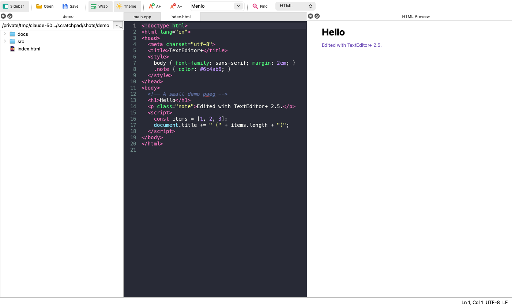

# TextEditor+

[](https://www.gnu.org/licenses/agpl-3.0)


A lightweight code and text editor for macOS, Windows and Linux, written in C++ with Qt 6.

TextEditor+ is fast native text editor that is an OS-native version of "Web TextEditor" (https://sjwrc.com/tools/editor/; https://github.com/swijeyes/Web-TextEditor), a browser-based editor developed by Sanjeeva Wijeyesakere and is hosted on sjwrc.com. It retains the same look and features while adding OS-native file handling, printing, find/replace and more.



## Features

- **Syntax highlighting** for HTML (including embedded `<script>` and `<style>`), CSS, JavaScript, C and C++, picked automatically from the file extension
- **Two themes:** Dracula (dark) and Eclipse (light)
- **Editing:** line numbers, current-line highlight, auto-indent, word wrap
- **Find and replace** with match case, whole word, regular expressions and `\1` back-references
- **Native file handling:** Open, Save, Save As and New with your system's file dialogs; an unsaved-changes marker in the title bar and a prompt before closing
- **Printing** of the whole file or a selection, in colours suited to paper
- **Fonts:** pick any installed monospace font and zoom with A+/A− or Ctrl/Cmd + scroll wheel
- **Faithful saving:** keeps each file's line endings (LF/CRLF) and encoding (UTF-8, or Latin-1 for files that aren't valid UTF-8). Saves are atomic, so a failed save never leaves a half-written file.
- **Safeguards:** won't open devices or pipes, asks before opening binary files or files over 50 MB, and refuses files over 512 MB
- Open files by dragging them onto the window or passing a path on the command line
- Remembers window size, font, theme and word-wrap setting

## Keyboard shortcuts

| Action | macOS | Windows / Linux |
|---|---|---|
| New / Open / Save | ⌘N / ⌘O / ⌘S | Ctrl+N / Ctrl+O / Ctrl+S |
| Save As | ⇧⌘S | Ctrl+Shift+S |
| Print | ⌘P | Ctrl+P |
| Find / Replace | ⌘F / ⌥⌘F | Ctrl+F / Ctrl+H (Ctrl+R on KDE) |
| Find next / previous | ⌘G / ⇧⌘G | F3 / Shift+F3 |
| Go to line | ⌘L | Ctrl+L |
| Zoom in / out / reset | ⌘= / ⌘− / ⌘0 | Ctrl+= / Ctrl+− / Ctrl+0 |
| Toggle word wrap | ⌥Z | Alt+Z |

## Building from source

You need **Qt 6.4 or later**, **CMake 3.21 or later** and a C++17 compiler.

### macOS

```sh
brew install qt cmake
cmake -S . -B build -DCMAKE_PREFIX_PATH="$(brew --prefix qt)"
cmake --build build
open "build/TextEditor+.app"
```

### Linux (Debian/Ubuntu)

```sh
sudo apt install qt6-base-dev cmake g++
cmake -S . -B build
cmake --build build
./build/TextEditor+
```

### Windows

Install Qt 6 with the [Qt Online Installer](https://www.qt.io/download-qt-installer) (choose an MSVC kit) and CMake. Then, from a *Developer Command Prompt for Visual Studio*:

```bat
cmake -S . -B build -DCMAKE_PREFIX_PATH=C:\Qt\6.x.x\msvc2022_64
cmake --build build --config Release
```

### Using qmake instead of CMake

```sh
mkdir build && cd build && qmake6 ../TextEditor.pro && make
```

## Packaging

Qt's deployment tools copy the Qt libraries into the app so it runs on machines without Qt installed:

- **macOS:** `macdeployqt "build/TextEditor+.app" -dmg`
- **Windows:** `windeployqt "build\Release\TextEditor+.exe"`
- **Linux:** [`linuxdeploy`](https://github.com/linuxdeploy/linuxdeploy) with its Qt plugin, which builds an AppImage

With Homebrew's Qt, `macdeployqt` reports that it can't resolve `QtSvg` and `QtPdf`. These are only needed by optional SVG/PDF image plugins that TextEditor+ doesn't use. Delete any plugin under `Contents/PlugIns` that links to them before signing.

### Signing on macOS

For use on your own Mac, an ad-hoc signature is enough:

```sh
codesign --force --deep -s - "build/TextEditor+.app"
```

To give the app to others, sign it with a Developer ID, turn on the hardened runtime, and notarize it:

```sh
codesign --force --deep --options runtime --timestamp \
    -s "Developer ID Application: <Your Name> (<TEAMID>)" "build/TextEditor+.app"
ditto -c -k --keepParent "build/TextEditor+.app" TextEditor+.zip
xcrun notarytool submit TextEditor+.zip --keychain-profile <profile> --wait
xcrun stapler staple "build/TextEditor+.app"
```

Don't combine `--options runtime` with an ad-hoc (`-s -`) signature. The hardened runtime then refuses to load the bundled Qt frameworks, and the app won't start.

## Project layout

| Path | Purpose |
|---|---|
| `src/main.cpp` | Application startup and command-line handling |
| `src/mainwindow.*` | Window, menus, toolbar, file handling, printing, settings |
| `src/codeeditor.*` | Editor widget: line numbers, current-line highlight, auto-indent |
| `src/highlighter.*` | Syntax highlighting for each language |
| `src/findbar.*` | Find/replace bar |
| `src/theme.h` | Dracula and Eclipse colour schemes |
| `resources/` | App icons |
| `CMakeLists.txt`, `TextEditor.pro` | Build files for CMake and qmake |

## Contributing

Bug reports and pull requests are welcome. By submitting a contribution, you agree that it is licensed under the same AGPLv3 terms as the rest of the project.

## License

Copyright © 2026 Sanjeeva Wijeyesakere

TextEditor+ is free software: you can redistribute it and/or modify it under the terms of the **GNU Affero General Public License** as published by the Free Software Foundation, either version 3 of the License, or (at your option) any later version.

TextEditor+ is distributed in the hope that it will be useful, but **without any warranty**; without even the implied warranty of merchantability or fitness for a particular purpose. See the [GNU Affero General Public License](LICENSE) for more details.

You should have received a copy of the GNU Affero General Public License along with this program. If not, see <https://www.gnu.org/licenses/>.

### Third-party components

TextEditor+ is built with the [Qt framework](https://www.qt.io/), used under the [GNU LGPL v3](https://www.gnu.org/licenses/lgpl-3.0.html). Qt's source code is available from [download.qt.io](https://download.qt.io/official_releases/qt/). Packaged builds also include libraries that Qt depends on, such as ICU, HarfBuzz, FreeType, PCRE2 and libpng, each under its own open-source license. All of these licenses are compatible with the AGPLv3.

## Author

**Sanjeeva Wijeyesakere**: [GitHub @swijeyes](https://github.com/swijeyes) · [sjwrc.com](https://sjwrc.com)
